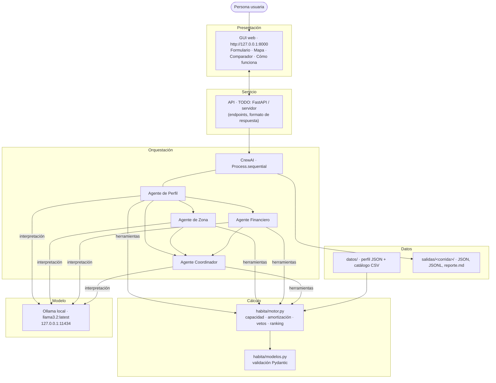

# Habita MX · Sistema multiagente de apoyo a decisiones de vivienda
 
**Entrega final · Inteligencia Artificial · NRC 30033 · Universidad Anáhuac Puebla · Equipo 6 · 2026**

Habita MX ayuda a una persona a decidir **qué vivienda puede comprar en la Zona Metropolitana del Valle de México y bajo qué escenario de financiamiento**, sin rebasar su capacidad de pago ni sus requisitos de seguridad, traslado y espacio. Cuatro agentes especializados en **CrewAI** con un LLM local (**Ollama · llama3.2**) analizan el perfil, evalúan zonas, simulan el crédito e integran un ranking explicable. Las cifras oficiales salen de un motor determinista en Python y el LLM solo las interpreta. La persona usuaria audita y decide en una interfaz web.
 
> Prototipo académico: el catálogo de 20 viviendas y las condiciones financieras son **simulados**. No constituye una oferta ni aprobación de crédito.
 
| Integrante | Matrícula |
|---|---|
| Berra Herrera, Oscar Santiago | 00561951 |
| Gil Calvillo, Carlos Alberto | 00622866 |
| López Flores, Carlos Alberto | 00569015 |
| Olmedo Paredes, Citlalli Izel | 00465194 |
| Pérez Rodríguez, Karla Angelica | 00608814 |
 
## 1. Descripción y arquitectura
 
### 1.1 ¿Por qué un sistema multiagente?
 
La decisión mezcla tres saberes con reglas distintas: perfil y restricciones del usuario, contexto territorial y matemática financiera. Separarlos en agentes con **una sola herramienta cada uno** hace que cada conclusión se pueda auditar por etapa, que cada agente se pueda probar por separado y que un error no se propague en silencio, como pasaría en un script monolítico. El Coordinador integra la evidencia con una política pública: **primero las restricciones obligatorias, después la suma ponderada y al final el desempate**.
 
### 1.2 Arquitectura por capas
 

 
**Comunicación:** TODO: indicar si la GUI llama a la API por REST (petición y respuesta) o recibe el avance por SSE o WebSockets. Hoy el modal muestra el estado de cada agente y lo confirma al terminar la corrida.
 
### 1.3 Marco PEAS
 
| | Especificación |
|---|---|
| **P · Desempeño** | 0 recomendaciones que violen restricciones obligatorias; 100 % de concordancia entre el ranking de los agentes y el motor de cálculo (`--modo calculo`); cifras trazables por etapa; tiempo de respuesta con modelo local; 25/25 pruebas aprobadas. |
| **E · Entorno** | Perfil financiero del usuario (ingreso, gastos, deudas, enganche, pago máximo) y catálogo de 20 viviendas simuladas en CDMX con indicadores normalizados 0–100: seguridad, riesgos, vivienda, movilidad y entorno. |
| **A · Actuadores** | Herramientas `consultar_perfil`, `evaluar_catalogo`, `calcular_financiamiento` e `integrar_evaluaciones`; ranking, alertas y descartes en la GUI; archivos de evidencia en `salidas/`. |
| **S · Sensores** | Formulario de la GUI o `perfil.json`, catálogo CSV, salidas aceptadas de las tareas previas (`Task.context`) y resultado de los validadores. |
 
**Propiedades del entorno:** parcialmente observable (datos simulados con cobertura incompleta), determinista en el cálculo y estocástico en la redacción del LLM, episódico (cada corrida es independiente), estático durante la corrida, discreto (catálogo finito) y multiagente cooperativo.
 
### 1.4 Agentes
 
| # | Agente | Goal | Herramienta | Contexto que recibe |
|---|---|---|---|---|
| 1 | Perfil del Usuario | Identificar restricciones obligatorias, preferencias y capacidad mensual sin inventar datos. | `consultar_perfil` | Datos del usuario |
| 2 | Evaluación de Zona | Evaluar cinco dimensiones territoriales, cobertura y cumplimiento del perfil. | `evaluar_catalogo` | Perfil aceptado |
| 3 | Financiero | Comprobar enganche, gastos iniciales, mensualidad y sensibilidad a tasa y plazo. | `calcular_financiamiento` | Perfil aceptado |
| 4 | Coordinador | Integrar evidencia y explicar el ranking sin recomendar alternativas que incumplan restricciones. | `integrar_evaluaciones` | Perfil, Zona y Financiero |
 
El *backstory* completo de cada agente está en `habita/equipo.py` (`ROLES`). Todos tienen `allow_delegation=False`, `max_iter=4` y `memory=False`. Colaboran solo mediante `Task.context` y evidencia compartida.
 
### 1.5 Guardrails y seguridad
 
- **Guardrail por tarea** (`guardrail_max_retries=2`): rechaza la respuesta si el agente no usó su herramienta, si omite IDs o si el ranking no coincide con el del motor.
- **Orden forzado:** cada herramienta exige que las tareas previas estén aceptadas (`exigir(...)`).
- **Cifras oficiales desde Python:** el número que se publica nunca es una copia redactada por el LLM.
- **Vetos antes que puntajes:** presupuesto, habitaciones, traslado, cobertura, seguridad, riesgos, enganche y capacidad de pago. Una buena puntuación nunca compensa una restricción incumplida.
- **Validación de entradas** con Pydantic: por ejemplo, el pago máximo no puede superar la capacidad calculada.
- **Herramientas acotadas:** sin acceso a archivos arbitrarios, red ni ejecución de código. La telemetría de CrewAI está desactivada.
- El escenario de **estrés** (+2 pp de tasa) se muestra como alerta, no como veto.
### 1.6 Human-in-the-Loop
 
La persona usuaria revisa el ranking, el mapa y el comparador. Puede auditar el razonamiento de cada agente en **Cómo funciona** y revisar las alertas (etiqueta **REVISAR**). TODO: describir la acción de aprobar o ajustar la recomendación final (botón, cambio de pesos, nuevo perfil).
 
---
 
## 2. Prerrequisitos de software
 
| Componente | Versión |
|---|---|
| Python | 3.11 |
| Conda (Anaconda o Miniconda) | Reciente |
| Ollama | Reciente, con `llama3.2:latest` |
| Git | Cualquiera |
 
- Dependencias: `requirements.txt`; versiones exactas de la demo en `requirements-lock.txt`.
- Ambiente: `environment.yml` (crea `habita-mx`).
- Variables: plantilla `.env.example`
```dotenv
OLLAMA_BASE_URL=http://127.0.0.1:11434
OLLAMA_MODEL=llama3.2:latest
OLLAMA_TIMEOUT=240
OLLAMA_NUM_CTX=8192
```
 
---
 
## 3. Instalación y despliegue
 
Los comandos funcionan en PowerShell (Windows) y en la terminal de macOS o Linux.
 
```bash
# 1. Clonar
git clone https://github.com/KarlaPerezR/IA_Habita_MX.git
cd IA_Habita_MX
 
# 2. Ambiente
conda env create -f environment.yml      # solo la primera vez
conda activate habita-mx
 
# 3. Variables de entorno
cp .env.example .env                     # PowerShell: Copy-Item .env.example .env
 
# 4. Modelo local
ollama pull llama3.2
ollama serve                             # en otra terminal, si la app de Ollama no está abierta
 
# 5. Diagnóstico: modelo, versiones y conexión con Ollama
python main.py --diagnostico
 
# 6. Levantar la interfaz
TODO: comando exacto para iniciar la GUI y la API (p. ej. uvicorn ... --port 8000)
# Abrir http://127.0.0.1:8000
```
 
Si `conda` no se reconoce en PowerShell, invócalo por su ruta (`$env:USERPROFILE\anaconda3\Scripts\conda.exe`). Si falta CrewAI, ejecuta `python -m pip install -r requirements.txt` dentro del ambiente.
 
---
 
## 4. Instrucciones de reproducción
 
Con el ambiente activo y Ollama en ejecución:
 
```bash
python -m pytest -q --basetemp tmp/pruebas                              # 25 passed
python main.py --modo calculo                                          # línea base sin IA
python main.py --modo crew                                             # 4 agentes con caso demo
python main.py --perfil datos/TODO_perfil_viable.json --zonas datos/zonas_demo.csv
python main.py --perfil datos/TODO_perfil_sin_opciones.json --zonas datos/zonas_demo.csv
```
 
### Casos sintéticos de la demostración en vivo
 
| Caso | Archivo | Datos clave | Resultado esperado |
|---|---|---|---|
| A · Perfil viable | `datos/TODO.json` | Ingreso 90,000 · pago máx. 37,000 · presupuesto 5,000,000 · enganche 800,000 · 2 hab. · traslado ≤ 60 min | **4 de 20** viviendas viables; mejor afinidad: Departamento Vallejo (58.0) |
| B · Restricciones estrictas | `datos/TODO.json` | TODO | **0 de 20** viables; los motivos de descarte aparecen en el reporte |
| Validación | GUI | Pago máximo 37,500 | La GUI bloquea el envío: "El pago máximo no puede superar $37,000" |
 
Durante la corrida, la terminal imprime `[herramienta]`, `[tarea_completada]` y `[validacion_rechazada]` por etapa. El registro completo queda en `interacciones.jsonl`.
 
### Salidas de cada corrida (`salidas/<corrida>/`)
 
| Archivo | Contenido |
|---|---|
| `reporte.md` | Ranking explicado, alertas y alternativas descartadas |
| `resultado.json` | Resultado consolidado, duración y metadatos |
| `interacciones.jsonl` | Herramientas usadas, validaciones y conclusiones por etapa |
| `perfil.json`, `zonas.json`, `finanzas.json`, `coordinacion.json` | Salida aceptada de cada agente |
| `calculos.json` | Evidencia numérica de todas las etapas |
| `entrada_perfil.json`, `entrada_zonas.csv` | Copia de las entradas |
| `error.json` | Solo si la corrida falla |
 
`evidencia/` contiene una corrida de referencia (`Habita_MX_ejecutado.ipynb`, `pruebas.txt` y hashes `sha256_entrega.json`).
 
### Reglas de entrada
 
- Montos en MXN. Ingresos, gastos, deudas y reserva son **mensuales**.
- Tasas y pesos como fracción (`0.105` = 10.5 %). Los seis pesos suman `1`.
- Indicadores territoriales de 0 a 100 en sentido favorable (en `riesgos`, 100 = menor exposición). Un campo vacío es un dato ausente.
---
 
## 5. Estructura del proyecto
 
| Ruta | Contenido |
|---|---|
| `main.py` | Entrada de terminal y diagnóstico |
| `habita/equipo.py` | Agentes, herramientas, tareas, guardrails y Crew |
| `habita/motor.py` | Cálculo financiero, restricciones y ranking |
| `habita/modelos.py` | Modelos y validación Pydantic |
| `habita/aplicacion.py` | Conexión con Ollama y exportación de resultados |
| TODO | Código de la GUI y la API |
| `Habita_MX.ipynb` | Cuaderno opcional (ver Anexo) |
| `datos/` | Perfiles y catálogo sintéticos |
| `tests/` | 25 pruebas automatizadas |
| `evidencia/` | Corrida de referencia |
| `salidas/` | Resultados locales |
 
---
 
## 6. Limitaciones y trabajo futuro
 
- Datos territoriales y financieros simulados; no hay conectores a fuentes oficiales (INEGI, AMAI, SHF, Infonavit).
- Sin CAT completo ni evaluación de aprobación crediticia.
- Modelo local pequeño: explicaciones breves que requieren revisión humana.
- Siguientes pasos: TODO (p. ej. datos reales por AGEB, streaming del avance por agente, despliegue en contenedor).
---
 
## Anexo · VS Code y Jupyter (opcional)
 
1. Instala las extensiones **Python** y **Jupyter** de Microsoft.
2. Selecciona el intérprete del ambiente `habita-mx` (Ctrl + Shift + P → *Python: Select Interpreter*).
3. Abre `Habita_MX.ipynb`, elige el kernel `habita-mx` y ejecuta todo. La primera celda imprime `sys.executable` para comprobar el ambiente.
---
 
## Referencias (APA 7)
 
CrewAI. (2025). *Agents*. CrewAI Documentation. https://docs.crewai.com/en/concepts/agents
 
CrewAI. (2025). *Tasks*. CrewAI Documentation. https://docs.crewai.com/en/concepts/tasks
 
CrewAI. (2025). *LLMs*. CrewAI Documentation. https://docs.crewai.com/en/concepts/llms
 
Meta. (2024). *Llama 3.2 3B Instruct* [Modelo de lenguaje]. Hugging Face. https://huggingface.co/meta-llama/Llama-3.2-3B-Instruct
 
Ollama. (2025). *Ollama* [Software]. https://ollama.com
 
Pydantic. (2025). *Pydantic documentation*. https://docs.pydantic.dev
 
Russell, S., & Norvig, P. (2021). *Artificial intelligence: A modern approach* (4th ed.). Pearson.
 
Wooldridge, M. (2009). *An introduction to multiagent systems* (2nd ed.). John Wiley & Sons.
