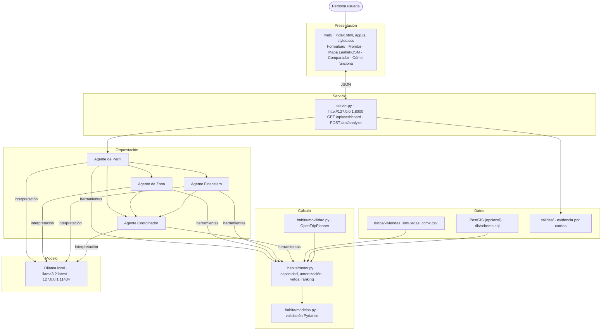

# Habita MX · Sistema multiagente de apoyo a decisiones de vivienda

**Entrega final · Inteligencia Artificial · NRC 30033 · Universidad Anáhuac Puebla · Equipo 6 · 2026**

Habita MX ayuda a una persona a decidir **qué vivienda puede comprar en la Ciudad de México y bajo qué escenario de financiamiento**, sin rebasar su capacidad de pago ni sus requisitos de seguridad, traslado y espacio. Cuatro agentes especializados en **CrewAI** con un LLM local (**Ollama · llama3.2**) analizan el perfil, evalúan las viviendas, simulan el crédito e integran un ranking explicable. Las cifras oficiales salen de un motor determinista en Python y el LLM solo las interpreta. La persona usuaria audita y decide en una interfaz web.

> Prototipo académico: el catálogo de 20 viviendas y las condiciones financieras son **simulados**. No constituye una oferta ni aprobación de crédito.

| Integrante | Matrícula |
|---|---|
| Berra Herrera, Oscar Santiago | 00561951 |
| Gil Calvillo, Carlos Alberto | 00622866 |
| López Flores, Carlos Alberto | 00569015 |
| Olmedo Paredes, Citlalli Izel | 00465194 |
| Pérez Rodríguez, Karla Angelica | 00608814 |

---

## 1. Descripción y arquitectura

### 1.1 ¿Por qué un sistema multiagente?

La decisión mezcla tres saberes con reglas distintas: el perfil y las restricciones del usuario, el contexto territorial y la matemática financiera. Separarlos en agentes con **una sola herramienta cada uno** permite auditar cada conclusión por etapa, probar cada agente por separado y evitar que un error se propague en silencio, como pasaría en un script monolítico. El Coordinador integra la evidencia con una política pública: **primero las restricciones obligatorias, después la suma ponderada y al final el desempate**.

### 1.2 Arquitectura por capas



**Comunicación:** la GUI se comunica con `server.py` por REST/JSON. `GET /api/dashboard` prepara el estado inicial y `POST /api/analyze` valida el perfil y ejecuta los cuatro agentes sobre las 20 viviendas. El servidor consulta primero PostGIS y, si la base no está disponible, usa el CSV como respaldo.

### 1.3 Marco PEAS

| | Especificación |
|---|---|
| **P · Desempeño** | 0 recomendaciones que violen restricciones obligatorias; cobertura de indicadores ≥ 80 %; trazabilidad de cada corrida; mismas entradas → mismo ranking numérico; tiempo de respuesta y satisfacción como metas de producción. |
| **E · Entorno** | Perfil financiero y de preferencias del usuario; 20 viviendas simuladas en CDMX con indicadores 0–100 de seguridad, riesgos, vivienda, movilidad y entorno; supuestos financieros didácticos. |
| **A · Actuadores** | Ranking con afinidad, mapa, fichas, escenarios Base / Estrés / 15 años, motivos de descarte, alertas, explicación por agente y archivos de evidencia. |
| **S · Sensores** | Formulario de la GUI, catálogo CSV o PostGIS, rutas de OpenTripPlanner, salidas aceptadas de tareas previas (`Task.context`) y resultado de los validadores. |

**Propiedades del entorno:** parcialmente observable, no determinista en el mundo real y determinista en el cálculo, dinámico pero estático durante cada corrida, mixto (principalmente discreto), episódico y multiagente cooperativo.

### 1.4 Agentes

| # | Agente | Goal | Herramienta | Contexto que recibe |
|---|---|---|---|---|
| 1 | Perfil del Usuario | Identificar restricciones obligatorias, preferencias y capacidad mensual sin inventar datos. | `consultar_perfil` | Datos del usuario |
| 2 | Evaluación de Zona | Evaluar cinco dimensiones territoriales, cobertura y cumplimiento del perfil. | `evaluar_catalogo` | Perfil aceptado |
| 3 | Financiero | Comprobar enganche, gastos iniciales, mensualidad y sensibilidad a tasa y plazo. | `calcular_financiamiento` | Perfil aceptado |
| 4 | Coordinador | Integrar evidencia y explicar el ranking sin recomendar alternativas que incumplan restricciones. | `integrar_evaluaciones` | Perfil, Zona y Financiero |

El *backstory* de cada agente está en `habita/equipo.py` (`ROLES`). Todos tienen `allow_delegation=False`, `max_iter=4` y `memory=False`, y se ejecutan con `Process.sequential`.

### 1.5 Guardrails y seguridad

- **Guardrail por tarea** (`guardrail_max_retries=2`): rechaza la respuesta si el agente no usó su herramienta, si omite IDs o si el ranking no coincide con el del motor.
- **Orden forzado:** cada herramienta exige que las tareas previas estén aceptadas.
- **Cifras oficiales desde Python:** el número publicado nunca es una copia redactada por el LLM.
- **Vetos antes que puntajes:** presupuesto, habitaciones, traslado, cobertura, seguridad, riesgos, enganche y capacidad de pago.
- **Validación de entradas** en navegador y en servidor: el pago máximo nunca puede superar `ingreso − gastos − deudas − reserva`.
- **Inferencia local y herramientas acotadas:** sin acceso a archivos arbitrarios, red ni ejecución de código; telemetría de CrewAI desactivada.

### 1.6 Human-in-the-Loop

La persona revisa sus entradas antes de enviarlas, audita el ranking, el mapa, los escenarios y las etiquetas COMPATIBLE / REVISAR, lee la explicación de cada agente en **Cómo funciona** y ajusta criterios con **Nuevo perfil**. El sistema nunca relaja restricciones por su cuenta. Los perfiles se guardan por ID de cliente en `.runtime/client_profiles.json`.

---

## 2. Prerrequisitos de software

| Componente | Versión |
|---|---|
| Python | 3.11 |
| Conda (Anaconda o Miniconda) | Reciente |
| Ollama | Reciente, con `llama3.2:latest` |
| Git | Cualquiera |
| PostgreSQL + PostGIS, OpenTripPlanner 2.10 | Opcionales |

Dependencias en `requirements.txt` (instaladas por `environment.yml`). Ollama se configura por variables de entorno con estos valores por defecto, por lo que no es obligatorio crear un archivo de configuración:

```dotenv
OLLAMA_BASE_URL=http://127.0.0.1:11434
OLLAMA_MODEL=llama3.2:latest
OLLAMA_TIMEOUT=240
OLLAMA_NUM_CTX=8192
```

---

## 3. Instalación y despliegue

```bash
# 1. Clonar
git clone https://github.com/KarlaPerezR/IA_Habita_MX.git
cd IA_Habita_MX

# 2. Ambiente
conda env create -f environment.yml      # solo la primera vez
conda activate habita-mx

# 3. Modelo local
ollama pull llama3.2
ollama serve                             # en otra terminal, si la app de Ollama no está abierta

# 4. Interfaz
python server.py
# Abrir http://127.0.0.1:8000
```

### Opcional: PostGIS

Inicia `docker-compose.data.yml`, instala `requirements-data.txt`, define `DATABASE_URL` a partir de `.env.data.example` y ejecuta el cargador. Crea el esquema PostGIS y hace una carga idempotente. Sin base de datos, el servidor usa el CSV.

### Opcional: movilidad con OpenTripPlanner

```bash
python pipeline/prepare_otp.py
pipeline/build_otp.sh
pipeline/start_otp.sh
```

La app indica si el tiempo de traslado proviene de OTP o de la estimación provisional. El GTFS oficial descargado en noviembre de 2026 tiene calendarios vencidos; por integridad metodológica no se alteran, así que el transporte público conserva la estimación y caminar, bicicleta y automóvil usan rutas OSM.

---

## 4. Instrucciones de reproducción

```bash
python pipeline/load_simulated_homes.py --validate-only   # valida el catálogo de 20 viviendas
python server.py                                          # abre http://127.0.0.1:8000
```

### Caso de la demostración en vivo

| Campo | Valor |
|---|---|
| ID / nombre | CLI-002 · Carlos Gil 2 |
| Ingreso / gastos / deudas / reserva | 90,000 / 13,000 / 10,000 / 30,000 MXN |
| Pago máximo / presupuesto | 37,000 / 5,000,000 MXN |
| Enganche / ahorro gastos iniciales | 800,000 / 300,000 MXN |
| Habitaciones / traslado máximo | 2 / 60 min · transporte público · salida 08:00 |
| Seguridad mínima | 40 |

**Resultado esperado:** capacidad mensual de **$21,500** y **4 de 20** viviendas viables (Vallejo, Azcapotzalco, Alameda y Olivar). Si se captura un pago máximo de 37,500, la GUI bloquea el envío porque supera el efectivo disponible.

Durante la corrida, la terminal imprime `[herramienta]`, `[tarea_completada]` y `[validacion_rechazada]` por etapa. La evidencia de cada ejecución desde la interfaz se guarda localmente en `.runtime/web_agent_runs/<ID de ejecución>/`, con la bitácora `interacciones.jsonl` y la salida aceptada de cada agente (`perfil.json`, `zonas.json`, `finanzas.json`, `coordinacion.json`). Las carpetas `salidas/` y `evidencia/` conservan corridas de referencia del motor.

---

## 5. Estructura del proyecto

| Ruta | Contenido |
|---|---|
| `server.py` | Servidor local de la interfaz y API (`/api/dashboard`, `/api/analyze`) |
| `web/` | Interfaz: `index.html`, `app.js`, `styles.css` |
| `habita/equipo.py` | Agentes, herramientas, tareas, guardrails y Crew |
| `habita/motor.py` | Cálculo financiero, restricciones y ranking |
| `habita/modelos.py` | Modelos y validación Pydantic |
| `habita/catalogo.py` | Carga del catálogo desde PostGIS o CSV |
| `habita/movilidad.py` | Consulta de rutas en OpenTripPlanner |
| `habita/aplicacion.py` | Conexión con Ollama y exportación de resultados |
| `datos/` | Catálogo de 20 viviendas simuladas en CDMX |
| `db/`, `pipeline/`, `otp/` | Esquema PostGIS, cargadores y configuración de OTP |
| `docs/` | Metodología del MVP y fuentes de datos reales |
| `Habita_MX.ipynb` | Cuaderno de trabajo |
| `evidencia/`, `salidas/` | Corridas de referencia del motor |

---

## 6. Limitaciones y trabajo futuro

- Indicadores territoriales y condiciones financieras simulados; la conexión a fuentes oficiales está documentada en `docs/fuentes_datos_reales.md`.
- Sin CAT completo ni evaluación de aprobación crediticia.
- La inferencia local tarda decenas de segundos; el monitor confirma el estado de los agentes al terminar la corrida.
- Siguientes pasos: sustituir indicadores provisionales con FGJ, Atlas de Riesgos, INEGI y DENUE; obtener un GTFS con calendarios vigentes; incorporar pruebas automatizadas y monitoreo de calidad de datos; mostrar el avance por agente en tiempo real; y configurar un despliegue con gestión segura de secretos.

---

## Referencias (APA 7)

CrewAI. (s. f.). *Agents*. CrewAI Documentation. Recuperado el 5 de noviembre de 2026, de https://docs.crewai.com/en/concepts/agents

CrewAI. (s. f.). *Tasks*. CrewAI Documentation. Recuperado el 5 de noviembre de 2026, de https://docs.crewai.com/en/concepts/tasks

Meta. (2024, 25 de septiembre). *Llama-3.2-3B-Instruct* [Modelo de lenguaje]. Hugging Face. https://huggingface.co/meta-llama/Llama-3.2-3B-Instruct

Ollama. (s. f.). *Introduction*. Ollama Documentation. Recuperado el 12 de noviembre de 2026, de https://docs.ollama.com/api/introduction

Russell, S., & Norvig, P. (2021). *Artificial intelligence: A modern approach* (4.ª ed.). Pearson.

Wooldridge, M. (2009). *An introduction to multiagent systems* (2.ª ed.). Wiley.

Built with Llama.